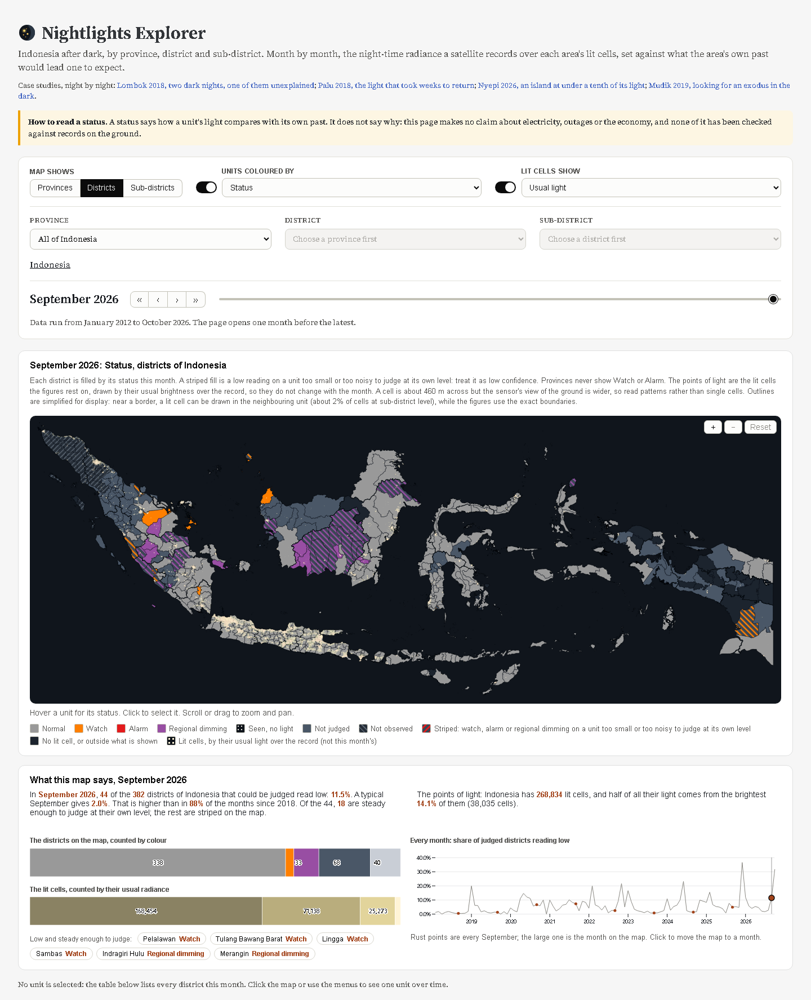
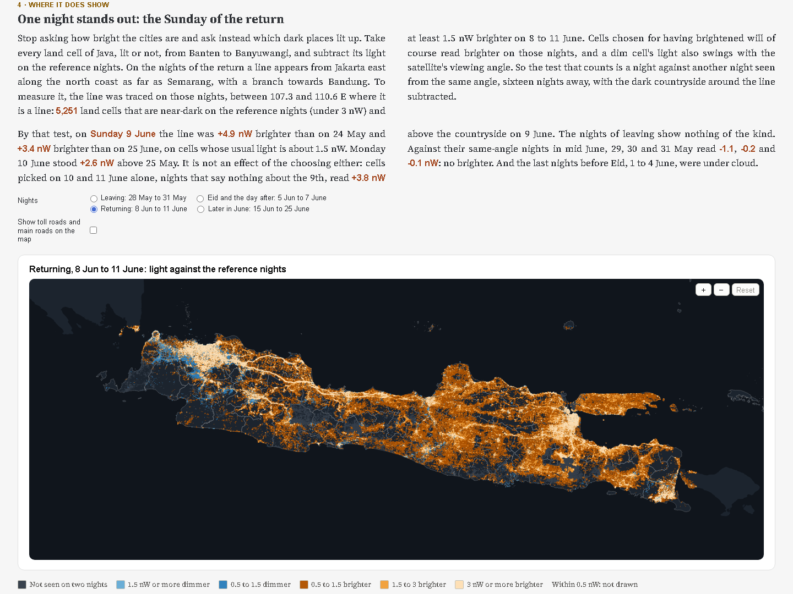

# Nightlights Explorer

Indonesia after dark, by province, district and sub-district: an interactive
dashboard of night-time lights seen from space, month by month from January
2012 to October 2026, with four case studies read night by night.

## What the dashboard can tell you

For any province, district or sub-district:

- **Is this place dimmer this month than its own past says it should be?**
- **Is the dimming its own, or shared with the area around it?**
- **Can the reading be trusted?** How much of the place was seen through
  the cloud, and whether it has enough steady light to be judged at all.
- **Has it lasted?** How many months a low reading has gone on, and how
  often that has happened before.
- **Is its light growing faster or slower than places like it** since 2012?
- **Where did new light appear**, where did existing light brighten, and
  where did it fade?
- **Where are the faint lights** that are too dim to count?
- **What did a known event look like from space?** Two earthquakes, a day
  of silence and a holiday exodus, followed night by night.

It describes the record up to October 2026. It is not a forecast and not a
warning service. It says how a place's light compares with its own past; it
does not say why, and it makes no claim about electricity, outages or the
economy.



<!-- Figure: a screenshot of the top of the main page (controls, map and the card "What this map says"), saved as docs/img/dashboard.png -->

## What is in it

**The monthly explorer.** A map of Indonesia with a slider over every month.
Units can be coloured by nine things (status, light against expected, how
well seen, months reading low, trend, newly lit cells and more) and the lit
cells, each about 460 m across, by six. A card under the map says what the
chosen layer shows that month, and a click opens any place over time.

**Four case studies.**

| Page | What it found |
|---|---|
| Lombok 2018 | Most of the dimming after the earthquakes was the angle the satellite looked from. Two nights stand out, one of them unexplained. |
| Palu 2018 | Under half the light on the night of the earthquake, and weeks to come back. |
| Nyepi 2026 | On the Balinese day of silence the island gave under a tenth of its light. |
| Mudik 2019 | The exodus before Eid does not show in the cities. On the roads one night stands out: the Sunday of the return. |



<!-- Figure: a screenshot of one case study (for example the Mudik map of Java on the return nights), saved as docs/img/case-study.png -->

## Read this before trusting a number

- Everything is relative to each place's own past. It is not a measure of
  electricity supply, poverty or economic activity, and nothing has been
  checked against records on the ground.
- In a typical month about 40% of units are not observed, because of cloud.
  "Not observed" is never the same as dark.
- A monthly value sees only large changes: the median unit would catch a
  one-month drop of about a third.
- Which cells count as lit is decided from the whole record, so the map uses
  knowledge a monitor would not have had at the time.
- Each case study rests on one event.

[docs/method.md](docs/method.md) gives the method in full: the data, the
equations, what was tested, what was tried and dropped, and a list of
practices for anyone processing night-lights data.

## Run it

The Black Marble files, the boundary file and the data the pipeline makes
from them (`site/data`) are not in this repository.
[docs/method.md, section 12](docs/method.md#12-running-it) lists the steps
from download to data. With `site/data` in place:

```
npm install
npm run build
npm run serve
```

and open http://localhost:3212. `npm run deploy` publishes the built site to
the `gh-pages` branch (see `tools/deploy.ps1`); `python -m pytest -q` runs
the tests.

## Built with

Python for the pipeline, written from scratch for this project (`src/ntl/`),
and [Observable Framework](https://observablehq.com/framework/) for the page,
with D3 and Observable Plot.

## Data

- Night-time lights: NASA Black Marble, Collection 2 (`VNP46A3` monthly,
  `VNP46A2` and `VNP46A1` daily), from NASA's LAADS archive.
- Admin boundaries: Badan Informasi Geospasial. Borders and names are shown
  as the source gives them and do not express any view on the status of a
  territory or its borders.
- Roads on the Mudik map: OpenStreetMap contributors, under the Open Database
  License 1.0.
- Earthquake facts: the United States Geological Survey catalogue.

## Author

Developed by [Benny Istanto](https://benny.istan.to) as a casual weekend
project.

## License

See [LICENSE](LICENSE).
